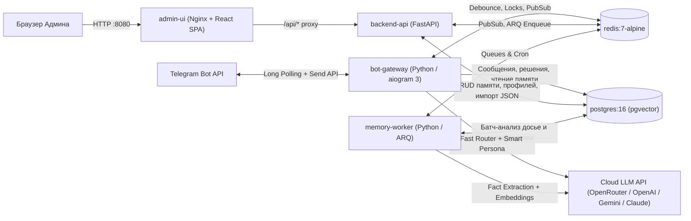

# Архитектура сервиса `bot_talker2` («Живой участник Telegram-группы»)

## 1. Обзор системы

Сервис представляет собой автономного участника Telegram-групп на базе официального **Telegram Bot API** (`aiogram 3`, Long Polling, выключенный `Privacy Mode`), который:
- читает сообщения и отслеживает реакции во всех подключённых группах;
- формирует **строго изолированную по каждой группе** трёхуровневую память (последние сообщения + редактируемое досье на каждого участника и контекст чата + векторные эпизоды в `pgvector`);
- поддерживает импорт старой истории чата из JSON-экспорта **Telegram Desktop** (`result.json`), чтобы изучить участников и контекст ретроспективно;
- выжидает окончание мысли собеседника (`Debounce` 3–7 секунд в Redis), прежде чем решить — промолчать, поставить эмодзи-реакцию или вступить в обсуждение;
- умеет самостоятельно инициировать диалоги в затихших чатах с учётом часового пояса, «тихих часов» и защиты от спама в пустоту;
- предоставляет веб-админку для просмотра и редактирования памяти (с защитой ручных правок `Admin Lock`), тонкой настройки поведения в каждой группе, чтения «мыслей бота» (`Decision Logs`) и ручной отправки реплик.

---

## 2. Контейнерная архитектура (`docker-compose.yml`)

Система разворачивается одной командой `docker compose up -d --build` и состоит из 6 сервисов (3 инфраструктурных/UI и 3 Python-процесса из единого образа):

### Роли контейнеров

1. **`postgres` (`pgvector/pgvector:pg16`)**: основное бессрочное хранилище текстовой истории чатов, настроек групп, карточек участников, атомарных фактов, векторных эпизодов (`HNSW` cosine index) и логов мыслей бота.
2. **`redis` (`redis:7-alpine`)**:
   - буфер ожидания конца мысли (`debounce` по группам);
   - счётчики и кулдауны ответов;
   - очередь фоновых задач `ARQ` (батч-анализ памяти, обработка импортированной истории);
   - `Pub/Sub` канал для мгновенных команд из админки в `bot-gateway` (ручная отправка сообщений/реакций) и live-обновлений `SSE`.
3. **`backend-api` (`FastAPI`)**: REST API + SSE поток для веб-админки, JWT-авторизация, загрузка `result.json` из Telegram Desktop.
4. **`bot-gateway` (`aiogram 3`)**: держит Long Polling соединение с Telegram, сохраняет апдейты, координирует `Debounce`, вызывает `Decision Engine`, имитирует набор текста (`typing`) и отправляет ответы/реакции.
5. **`memory-worker` (`ARQ`)**: фоновый процесс, который пачками изучает участников и обновляет контекст группы (не блокируя ответы бота в реальном времени), а также запускает крон-проверку спонтанной инициативы.
6. **`admin-ui` (`Nginx + React + TypeScript + Tailwind`)**: единая точка входа на порту `:8080`, раздаёт SPA и проксирует `/api/*` на `backend-api:8000`.

---

## 3. Пайплайны работы

### 3.1. Реакция на сообщения в реальном времени (`Debounce + Decision Router`)
1. Каждое входящее текстовое сообщение (или подпись к медиа) сохраняется в таблицу `messages` бессрочно, а профиль отправителя автоматически регистрируется/обновляется в `group_members` конкретной группы.
2. В Redis взводится/продлевается ключ ожидания `debounce:{group_id}` на `debounce_seconds` (по умолчанию `4.5` сек; при прямом реплае боту или `@mention` задержка сокращается вдвое).
3. Когда поток реплик стихает и таймер истекает:
   - проверяются бесплатные **Hard Gates** (активность бота в группе, часовой лимит сообщений бота, кулдаун после прошлого ответа, если бота не тегнули напрямую);
   - **Fast LLM** получает компактное окно последних сообщений, сводку группы, краткие профили авторов и уровень общительности `chattiness_level`, возвращая JSON-решение: `ignore`, `react` (эмодзи), `reply` или `message` + `reasoning` + опциональный `memory_query`;
   - если выбран ответ (`reply` / `message`), подтягивается полное досье собеседников, закреплённые факты и топ релевантных эпизодов из `pgvector`, после чего **Smart LLM** генерирует живую реплику в стиле Персоны этой группы;
   - бот выдерживает реалистичную паузу со статусом `typing` и отправляет сообщение в группу;
   - любой исход (включая `ignore` с объяснением причины) фиксируется в `decision_logs`.

### 3.2. Фоновое изучение участников и защита правок (`Admin Lock`)
- Когда в группе накапливается `memory_batch_size` (по умолчанию 25) непроанализированных сообщений (или проходит 30 минут тишины при наличии новых сообщений, либо нажата кнопка в админке), `memory-worker` запускает задачу `analyze_group_memory`.
- LLM анализирует батч диалога и предлагает обновления для:
  - саммари группы, локальных мемов/правил и активных тем;
  - характера, стиля речи и отношения бота к участникам;
  - атомарных фактов об участниках (`member_facts`);
  - смысловых эпизодов беседы (`memory_episodes` + вектор `embedding`).
- **Гарантия `Admin Lock`**: все поля с флагом `*_locked = true` и факты с `is_pinned = true` защищены в коде `MemoryService` — ИИ видит их как неизменяемую истину и может лишь дополнять карточку новыми фактами.

### 3.3. Импорт истории из Telegram Desktop (`JSON Import`)
- В админке на странице группы можно загрузить файл `result.json` из стандартного экспорта истории чата Telegram Desktop.
- `ImportService` дедуплицирует сообщения по `telegram_message_id`, создаёт карточки участников группы, пакетно записывает всю историю в `messages` и ставит в очередь `ARQ` фоновую нарезку истории на хронологические батчи для построения досье и векторной памяти.

### 3.4. Спонтанная инициатива (`Proactive Engine`)
- Каждые 5 минут крон-задача в `memory-worker` проверяет группы с `proactive_enabled = true`:
  1. Текущее локальное время группы (`timezone`) не входит в `quiet_hours_start .. quiet_hours_end`.
  2. В чате тишина не менее `min_silence_minutes` и выдержан интервал с прошлой инициативы.
  3. **Anti-Spam Guard**: после прошлого инициативного сообщения бота в чате были ответы от живых людей (бот никогда не пишет два инициативных сообщения подряд в мёртвый чат).
  4. Проходит вероятностная проверка `proactive_chance_per_hour`, после чего `Smart LLM` генерирует естественный заход на основе интересов участников или прошлых тем, и отправляет команду публикации через Redis в `bot-gateway`.

